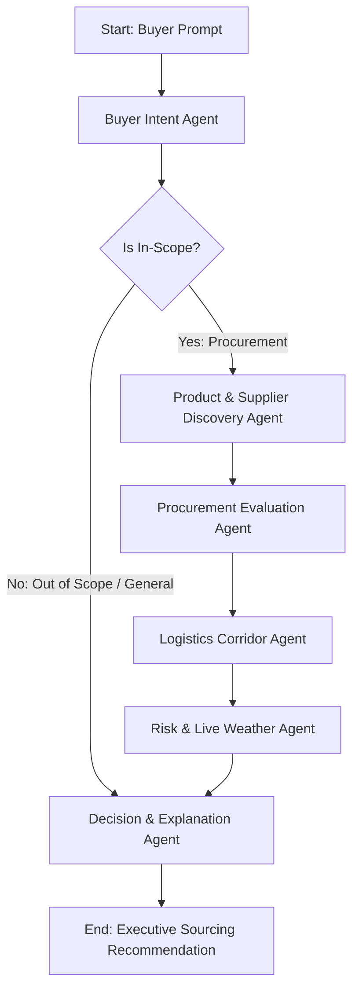

# BharatLink Nexus AI — Architecture Specification

## 1. High-Level Architecture Overview

BharatLink Nexus AI is an **Agentic Retail & Commerce Intelligence Platform** engineered for authentic Indian artisan collectives, institutional B2B buyers, retail sellers, and platform administrators.

```
                        ┌────────────────────────────────────────────────────────┐
                        │             Clients & User Personas                    │
                        │   (Buyers, Retailers, Artisans, Admins, Mobile/Web)    │
                        └───────────────────────────┬────────────────────────────┘
                                                    │ HTTPS / REST / Web UI
                                                    ▼
┌───────────────────────────────────────────────────────────────────────────────────────────────┐
│                                 Google Cloud Run (0.0.0.0:$PORT)                              │
│  ┌─────────────────────────────────────────────────────────────────────────────────────────┐  │
│  │                               FastAPI Application Layer                                 │  │
│  │  - Routing & Jinja2 SSR Templates (/templates, /templates/seller)                       │  │
│  │  - Static Asset Delivery (/static)                                                      │  │
│  │  - Health & Readiness Probes (/health, /health/ready)                                   │  │
│  │  - Session & Authentication Verification (Firebase ID Token / HMAC-Signed Cookie)       │  │
│  │  - Role-Based Access Control (Buyer, Seller, Admin)                                     │  │
│  │  - Rate Limiting, Request Validation (Pydantic V2), Error Masking                       │  │
│  └───────────────┬───────────────────────────────────────┬─────────────────────────────────┘  │
│                  │                                       │                                    │
│                  ▼                                       ▼                                    │
│  ┌──────────────────────────────┐       ┌──────────────────────────────────────────────────┐  │
│  │  LangGraph Multi-Agent Engine │       │      Retail & Commerce Intelligence Services     │  │
│  │  - Buyer Intent Agent        │       │  - Product Discovery (Semantic & Attribute)      │  │
│  │  - Product Discovery Agent   │       │  - Customer Preferences & Personalization        │  │
│  │  - Procurement Eval Agent    │       │  - Real-Time Inventory Intelligence & Oversell   │  │
│  │  - Logistics Corridor Agent  │       │  - Demand Forecasting (Moving Avg/Holt-Winters)  │  │
│  │  - Live Weather Risk Agent   │       │  - Basket & Co-Purchase Analytics                │  │
│  │  - Decision & Report Agent   │       │  - Business Decision Assistant (Seller AI)       │  │
│  └───────────────┬──────────────┘       └────────────────────────┬─────────────────────────┘  │
│                  │                                               │                            │
│                  ▼                                               ▼                            │
│  ┌─────────────────────────────────────────────────────────────────────────────────────────┐  │
│  │                           Centralized AI Provider Layer                                 │  │
│  │  - Primary: Google Gemini 2.5 Flash via Google Gen AI SDK (gemini-2.5-flash)           │  │
│  │  - Vertex AI Mode / Developer API Mode Auto-Selection                                   │  │
│  │  - Secondary: Groq LLM Provider (configurable)                                          │  │
│  │  - Circuit Breakers, Timeouts, Exponential Retries, Usage Tracking                     │  │
│  └─────────────────────────────────────────────────────────────────────────────────────────┘  │
│                                                  │                                            │
│                                                  ▼                                            │
│  ┌─────────────────────────────────────────────────────────────────────────────────────────┐  │
│  │                            Repository & Database Layer                                  │  │
│  │  - Firebase Admin SDK (Auth & Firestore)                                                │  │
│  │  - Cloud Firestore / Firebase Emulator / Safe In-Memory Repository Fallback             │  │
│  │  - Collections: users, seller_profiles, products, inventory_movements, orders, etc.     │  │
│  │  - ACID Transactions for Inventory Stock Operations                                     │  │
│  └─────────────────────────────────────────────────────────────────────────────────────────┘  │
└───────────────────────────────────────────────────────────────────────────────────────────────┘
                                                   │
                                                   ▼
┌───────────────────────────────────────────────────────────────────────────────────────────────┐
│                                   Google Cloud Platform                                       │
│    - Cloud Firestore (NoSQL Document Store with Security Rules & Indexes)                    │
│    - Vertex AI (Gemini Foundation Models)                                                     │
│    - Cloud Run (Fully managed serverless container runtime)                                   │
│    - Cloud Secret Manager (Production secrets: API keys, certificates)                        │
└───────────────────────────────────────────────────────────────────────────────────────────────┘
```

---

## 2. Authentication & Authorization Design

### 2.1 Identity Verification
- Authentication is governed by **Firebase Authentication** combined with the **Firebase Admin SDK** on the FastAPI backend.
- Client requests present verified Firebase ID tokens (or cryptographically signed session cookies created upon verified login).
- Identity (`uid`), role (`buyer`, `seller`, `admin`), and tenant metadata (`seller_id`) are derived strictly on the backend from verified tokens. Frontend headers or unverified request bodies are never trusted for authorization.

### 2.2 Role-Based Access Control (RBAC) Matrix
| Resource / Action | Anonymous | Buyer | Seller | Admin |
|---|---|---|---|---|
| Public Catalog & SEO Pages (`/`, `/crafts`, `/regions`, `/resources`) | Read | Read | Read | Read |
| AI Procurement Studio (`/procure`, `/api/procurement`) | ❌ | Read / Create | Read / Create | Full |
| Buyer History & Saved Plans (`/history`, `/saved`, `/profile`) | ❌ | Own Records Only | ❌ | Full |
| Seller Dashboard & Catalog (`/seller-central/dashboard`, `/products`) | ❌ | ❌ | Own Products Only | Full |
| Stock Updates (`/seller-central/inventory/update`) | ❌ | ❌ | Own Products Only | Full |
| Order Status Updates (`/seller-central/inventory/update-order-status`)| ❌ | ❌ | Own Orders Only | Full |
| Seller Approval & Admin Portal (`/seller-central/admin/*`) | ❌ | ❌ | ❌ | Full |
| Retail Analytics & Business Assistant (`/seller-central/analytics`) | ❌ | ❌ | Own Analytics Only | Full System |

---

## 3. Data Architecture & Firestore Schema

Cloud Firestore serves as the single source of truth:

```
firestore/
  ├── users/{uid}
  │     ├── uid: string
  │     ├── email: string
  │     ├── full_name: string
  │     ├── role: 'buyer' | 'seller' | 'admin'
  │     ├── company_name: string
  │     ├── created_at: ISO8601
  │     └── updated_at: ISO8601
  │
  ├── seller_profiles/{sellerId}
  │     ├── id: string
  │     ├── user_id: string (ref: users/{uid})
  │     ├── business_name: string
  │     ├── contact_person: string
  │     ├── email: string
  │     ├── phone: string
  │     ├── whatsapp_number: string
  │     ├── state: string
  │     ├── city: string
  │     ├── craft_category: string
  │     ├── craft_certification: string
  │     ├── verification_status: 'Pending Admin Approval' | 'Verified'
  │     ├── active: boolean
  │     └── created_at: ISO8601
  │
  ├── products/{productId}
  │     ├── id: string
  │     ├── seller_id: string (ref: seller_profiles/{sellerId})
  │     ├── seller_name: string
  │     ├── name: string
  │     ├── description: string
  │     ├── category: string
  │     ├── subcategory: string
  │     ├── region: string
  │     ├── price: number (INR)
  │     ├── available_stock: integer
  │     ├── minimum_order_quantity: integer
  │     ├── weight_kg: number
  │     ├── authenticity_status: string
  │     ├── image_url: string
  │     ├── active: boolean
  │     ├── created_at: ISO8601
  │     └── updated_at: ISO8601
  │
  ├── inventory_movements/{movementId}
  │     ├── id: string
  │     ├── product_id: string
  │     ├── seller_id: string
  │     ├── previous_stock: integer
  │     ├── new_stock: integer
  │     ├── delta: integer
  │     ├── reason: string
  │     ├── updated_by: string (userId)
  │     └── created_at: ISO8601
  │
  ├── procurement_requests/{requestId}
  │     ├── id: string
  │     ├── user_id: string
  │     ├── raw_prompt: string
  │     ├── product_type: string
  │     ├── quantity: integer
  │     ├── destination: string
  │     ├── deadline_days: integer
  │     ├── budget_inr: number
  │     ├── status: 'completed' | 'in_progress'
  │     └── created_at: ISO8601
  │
  ├── orders/{orderId}
  │     ├── id: string
  │     ├── request_id: string
  │     ├── buyer_id: string
  │     ├── seller_id: string
  │     ├── product_id: string
  │     ├── quantity: integer
  │     ├── total_cost: number
  │     ├── status: 'Pending' | 'Stock Delivered' | 'Cancelled'
  │     └── created_at: ISO8601
  │
  ├── sales_transactions/{transactionId}
  │     ├── id: string
  │     ├── order_id: string
  │     ├── product_id: string
  │     ├── seller_id: string
  │     ├── buyer_id: string
  │     ├── units_sold: integer
  │     ├── unit_price: number
  │     ├── total_amount: number
  │     ├── category: string
  │     └── timestamp: ISO8601
  │
  ├── customer_preferences/{userId}
  │     ├── user_id: string
  │     ├── preferred_categories: string[]
  │     ├── max_budget: number
  │     ├── destination: string
  │     ├── consent_given: boolean
  │     └── updated_at: ISO8601
  │
  └── audit_logs/{logId}
        ├── id: string
        ├── action: string
        ├── user_id: string
        ├── role: string
        ├── resource: string
        ├── timestamp: ISO8601
        └── details: object
```

---

## 4. Multi-Agent LangGraph Workflow

The LangGraph orchestration coordinates 6 dedicated agents communicating via typed `GraphState`:



### Agent Responsibilities & Guardrails:
1. **Buyer Intent Agent**:
   - Parses natural language into typed parameters (`productType`, `quantity`, `destination`, `deadlineDays`, `budgetInr`).
   - Identifies non-shopping greetings and commercial electronics outside the artisan scope.
2. **Product & Supplier Discovery Agent**:
   - Executes deterministic database queries against Firestore catalog.
   - Zero hallucination: Returns empty if product is absent rather than inventing stock.
3. **Procurement Evaluation Agent**:
   - Ranks candidate artisan sellers by stock availability, unit price, and certifications.
   - Calculates exact arithmetic costs deterministically (`quantity * unit_price`).
4. **Logistics Corridor Agent**:
   - Maps multi-hub transit corridor without fabricating freight rates.
5. **Risk & Disruption Agent**:
   - Fetches live weather metrics using real-time Open-Meteo API.
   - Evaluates corridor safety and transit impact based on real meteorological conditions.
6. **Decision & Explanation Agent**:
   - Formulates executive recommendation with verified seller contacts and structured breakdowns.

---

## 5. Retail & Commerce Intelligence Subsystems

1. **Intelligent Product Discovery**:
   - Dual search: Tokenized keyword extraction + semantic vector/attribute scoring.
   - Filters by category, GI certification, region, and in-stock inventory.
2. **Personalization Engine**:
   - Tracks explicit buyer preferences (with user consent).
   - Re-ranks discovery candidates according to past purchasing patterns without fabricating data.
3. **Inventory Intelligence & Oversell Protection**:
   - Real-time stock status (`In Stock`, `Low Stock < 15`, `Out of Stock`).
   - Transactional decrement: Uses atomic transactions to prevent concurrent orders from overselling inventory.
   - Auto-generated replenishment recommendations based on sales velocity.
4. **Demand Forecasting Service**:
   - Implements baseline statistical methods (Moving Average, Weighted Trend) on actual sales transaction records.
   - Transparently displays sample size, forecast horizon (30/60 days), and confidence bounds.
   - Labels sparse data honestly; uses tagged demonstration baseline only if zero sales exist.
5. **Customer & Product Analytics**:
   - Bestselling products by units and revenue.
   - Category performance distribution.
   - Basket analysis: Co-purchased item pairings calculated from multi-item orders.
   - Behavioral segmentation (e.g. Bulk Institutional, Boutique Retailer, High-Frequency Buyer).
6. **Business Decision Assistant**:
   - Seller-facing conversational AI querying live database functions to answer business queries (stockout risks, fast-moving items, unfulfilled buyer requests).

---

## 6. Google Cloud Deployment Architecture

- **Runtime**: Google Cloud Run serverless container instance.
- **Port**: Bound to `0.0.0.0` with `$PORT` dynamic environment variable support.
- **Packaging**: Containerized via production `Dockerfile`, including all compiled Jinja2 templates and `/static` assets.
- **Observability**: Structured JSON logging, `/health` and `/health/ready` probe endpoints.
- **Zero Local Dependency**: App operates without local `.env` files; secrets loaded via Cloud Run environment variables or Google Secret Manager.
